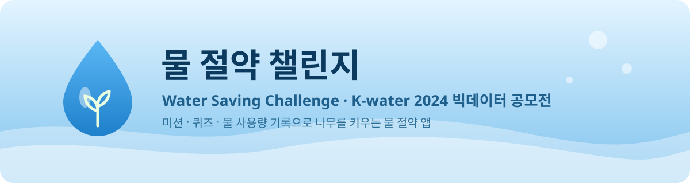

<p align="center">
  
</p>

# 물 절약 챌린지

2024 K-water 대국민 물 빅데이터 공모전에 냈던 앱이고, 장려상을 받았습니다.

물 아끼는 습관을 게임처럼 만들어 보자는 생각에서 시작했습니다. 하루 미션을 하거나 물 상식 퀴즈를 풀고, 그날 쓴 물의 양을 기록하면 포인트가 쌓입니다. 모은 포인트로 정원의 나무를 키울 수 있고, 지도에서는 내가 사는 시군구의 월별 물 스트레스 지수를 볼 수 있습니다.

<p align="center">
  
</p>

## 기능

- 오늘의 미션: 짧게 샤워하기, 양치할 때 컵 쓰기, 빨래 모아서 하기 같은 하루 미션
- 물 절약 퀴즈: 물 상식 OX 퀴즈
- 물 사용량 기록: 가족 수와 오늘 쓴 물의 양을 넣으면 1인당 사용량을 계산
- 가상 정원: 물, 비료, 영양제 아이템으로 나무를 7단계까지 키우고 사과를 수확
- 상점과 순위: 포인트로 아이템을 사고, 점수 순위는 Firestore에 저장
- 물 스트레스 지도: 전국 229개 시군구의 월별 물 스트레스 지수(WRI Aqueduct)

## 만든 방법

Flutter와 Dart로 만들었습니다. 로그인과 순위는 Firebase(Authentication, Firestore)를 썼고, 지도는 flutter_map과 OpenStreetMap 타일 위에 GADM 시군구 경계를 얹었습니다. 물 스트레스 지수는 WRI Aqueduct 4.0의 월별 값을 시군구별로 정리해 `assets/level2.csv`에 넣었습니다.

```
lib/
  main.dart            앱 시작과 화면 이동
  pages/               홈, 미션, 퀴즈, 물 사용량, 정원, 상점, 순위, 지도, 프로필, 로그인
  models/              나무 레벨과 경험치
  data/                퀴즈 문항
  score_manager.dart   포인트와 순위
assets/                나무 그림, 물 스트레스 지수, 글꼴
tool/fetch_gadm.sh     시군구 경계 내려받기
```

## 실행하기

```bash
flutter pub get

# 각자의 Firebase 프로젝트를 연결해야 합니다
dart pub global activate flutterfire_cli
flutterfire configure        # lib/firebase_options.dart 생성
                             # (또는 lib/firebase_options.example.dart를 복사해 값 채우기)

# GADM 경계는 재배포가 안 돼서 저장소에 넣지 않았습니다
./tool/fetch_gadm.sh

flutter run
```

## 자료 출처

- 물 스트레스 지수: [WRI Aqueduct 4.0](https://www.wri.org/aqueduct) (CC BY 4.0)
- 행정구역 경계: [GADM 4.1](https://gadm.org) (학술·비상업 용도)
- 지도 타일: © [OpenStreetMap](https://www.openstreetmap.org/copyright) contributors
- 글꼴: [배달의민족 한나체 Air, 도현체](https://www.woowahan.com/fonts)

## 만든 사람

[deerimhere](https://github.com/deerimhere), [parkbjgit](https://github.com/parkbjgit), [obh3706](https://github.com/obh3706), 이상욱 · 2024년 7–8월
